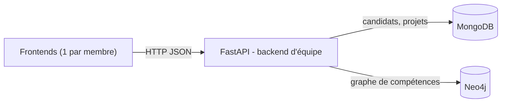
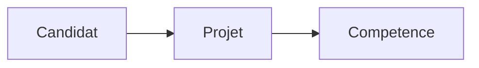

# 🧠 ARCHITECTURE - Équipe `TODO-nom-equipe`

> **Jalon 1** : ce document est votre **spécification**. Il doit être **complet** : toute l'équipe va coder dessus.
> Toutes les sections sont obligatoires. Remplacez **tous** les `TODO` (la CI « Livrables » les compte).
> En soutenance (5 à 6 min), vous présenterez surtout la **section 1** (schéma) et le contrat `API_ROUTES.md`.

## 1. Schéma d'architecture

Montrez **qui stocke quoi** et **quels flux** : frontends → API → MongoDB / Neo4j.

**Recommandé : [Excalidraw](https://excalidraw.com)** (à plusieurs via *Live collaboration*). Exportez en PNG ou SVG avec **« Embed scene »** coché,
enregistrez dans `docs/architecture.excalidraw.png`, puis remplacez le schéma Mermaid ci-dessous par :

``

L'image reste modifiable : rouvrez-la dans Excalidraw (ou dans VS Code avec l'extension *Excalidraw*).



TODO : en 3 à 5 lignes, le rôle de chaque base dans votre portfolio.

## 2. Les requêtes à servir

| # | Besoin (vu par un recruteur) | Route API | Base(s) interrogée(s) |
|---|---|---|---|
| R1 | Profil + timeline (expériences, formations) d'un candidat | `GET /api/candidats/{slug}` | MongoDB |
| R2 | Projets d'un candidat, filtrables par compétence | `GET /api/candidats/{slug}/projets` | MongoDB |
| R3 | Statistiques d'un candidat par compétence | `GET /api/candidats/{slug}/stats` | MongoDB |
| R4 | Projets similaires à un projet | `GET /api/graph/projets/{slug}/similaires` | Neo4j |
| R5 | Graphe de compétences d'un candidat | `GET /api/graph/competences/{slug}` | Neo4j |
| R6 | Liste des candidats possédant une compétence donnée | GET /api/competences/{slug}/candidats | Neo4j |
| R7 | Afficher les projets utilisant une technologie donnée | GET /api/competences/{slug}/projets | Neo4j |
| R8 | Afficher les candidats ayant participé à un projet commun | GET /api/graph/projets/{slug}/candidats | Neo4j |

## 3. Modèle MongoDB

### 3.1 Collection `candidats` - pattern TODO (*Embedding* ? *Referencing* ?)

```json
{
  "candidat_slug": "alice-martin",
  "nom": "Martin",
  "prenom": "Alice",
  "email": "alice.martin@example.com",
  "titre": "Développeuse Data",
  "localisation": "Paris",
  "description": "Développeuse spécialisée en data et développement logiciel.",

  "experiences": [
    {
      "poste": "Data Analyst",
      "entreprise": "Tech Solutions",
      "date_debut": "2023-01",
      "date_fin": "2024-06",
      "description": "Analyse et exploitation de données."
    }
  ],

  "formations": [
    {
      "diplome": "Master Informatique",
      "etablissement": "Université de Paris",
      "annee_debut": 2021,
      "annee_fin": 2023
    }
  ],

  "created_at": "2026-11-16",
  "updated_at": "2026-11-16"
}
```

**Justification** (cardinalité bornée ou non, lecture en une requête, fréquence de mise à jour) : **Pattern choisi : Embedding**

Les expériences et formations sont intégrées au document du candidat, car leur nombre est limité et elles sont généralement consultées avec son profil. Cela permet de récupérer toutes ces informations en une seule requête.

### 3.2 Collection `projets` - pattern TODO

```json
{
  "projet_slug": "smartcity-explorer",
  "titre": "SmartCity Explorer",
  "description": "Application d'analyse des données urbaines.",
  "candidat_slug": "alice-martin",
  "date_debut": "2025-01",
  "date_fin": "2025-06",
  "competences": [
    "python",
    "mongodb",
    "fastapi"
  ],
  "technologies": [
    "Python",
    "MongoDB",
    "FastAPI"
  ]
}
```

**Justification** : **Pattern choisi : Referencing**

Les projets sont stockés séparément et reliés aux candidats par leur `candidat_slug`. Cela facilite leur consultation, leur modification et leur filtrage indépendamment du profil.

### 3.3 Index

| Collection | Index | Requête servie (R#) |
|---|---|---|
| candidats | candidat_slug | R1 |
| projets | projet_slug | R2, R4 |
| projets | candidat_slug | R2 |
| projets | competences | R2, R3 |

### 3.4 Pipeline d'agrégation clé (R3)

```javascript
TODO : db.projets.aggregate([
  {
    $match: {
      candidat_slug: "alice-martin"
    }
  },
  {
    $unwind: "$competences"
  },
  {
    $group: {
      _id: "$competences",
      nombre: { $sum: 1 }
    }
  },
  {
    $sort: {
      nombre: -1
    }
  }
]);
```

## 4. Modèle Neo4j

### 4.1 Schéma du graphe



| Label | Propriétés | Clé unique |
|---|---|---|
| Candidat | candidat_slug, nom, prenom | candidat_slug |
| Projet | projet_slug, titre, description | projet_slug |
| Competence | skill_slug, nom | skill_slug |

| Relation | De → Vers | Propriétés | Pourquoi ce sens |
|---|---|---|---|
| REALISE | Candidat → Projet | aucune | Le candidat réalise le projet |
| UTILISE | Projet → Competence | aucune | Le projet mobilise des compétences |

### 4.2 Les 3 requêtes Cypher clés

```cypher
// R4 - projets similaires
MATCH (p:Projet {projet_slug: $slug})
      -[:UTILISE]->(s:Competence)
      <-[:UTILISE]-(autre:Projet)
WHERE autre.projet_slug <> $slug
RETURN autre.projet_slug AS projet,
       autre.titre AS titre,
       count(s) AS competences_communes
ORDER BY competences_communes DESC

// R5 - graphe de compétences d'un candidat
MATCH (c:Candidat {candidat_slug: $slug})
      -[:REALISE]->(p:Projet)
      -[:UTILISE]->(s:Competence)
RETURN c, p, s

// Compétences communes aux membres de l'équipe (ou requête de votre choix)
MATCH (c1:Candidat)-[:REALISE]->(:Projet)
      -[:UTILISE]->(s:Competence)
      <-[:UTILISE]-(:Projet)<-[:REALISE]-(c2:Candidat)
WHERE c1.candidat_slug < c2.candidat_slug
RETURN c1.nom AS candidat1,
       c2.nom AS candidat2,
       collect(DISTINCT s.nom) AS competences_communes
```

### 4.3 Contraintes

```cypher
TODO : CREATE CONSTRAINT ... IF NOT EXISTS
```

## 5. Cohérence entre les bases (slugs pivots)

| Entité | Slug | Dans MongoDB | Dans Neo4j |
|---|---|---|---|
| Candidat | `candidat_slug` (ex. `alice-martin`) | Collection candidats | Nœud Candidat |
| Projet | `projet_slug` (ex. `smartcity-explorer`) | Collection projets | Nœud Projet |
| Compétence | `skill_slug` (ex. `mongodb`) | Champ competences dans projets | Nœud Competence |

**Suppression d'un projet** : que faites-vous dans chaque base ? 
Lors de la suppression d'un projet, le document correspondant est supprimé dans MongoDB et le nœud associé ainsi que ses relations sont supprimés dans Neo4j. Les deux opérations sont coordonnées par l'API afin de maintenir la cohérence des données.

## 6. Répartition du travail

| Membre (pseudo GitHub) | Backend (couches / routes) | Frontend |
|---|---|---|
| TODO | TODO | `frontends/frontend-TODO/` |
