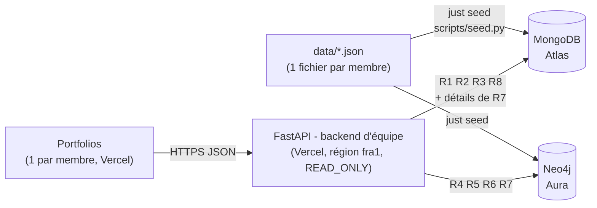
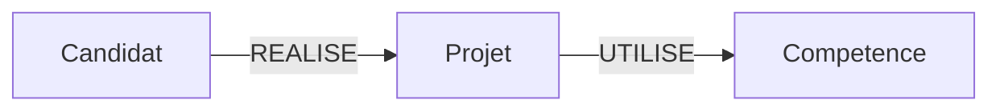

# 🧠 ARCHITECTURE - Équipe `les-apprentis`

> Spécification du backend d'équipe (FastAPI + MongoDB + Neo4j) et des portfolios.
> Contrat d'interface détaillé (paramètres, réponses, requêtes exécutées) : [`API_ROUTES.md`](API_ROUTES.md).

## Liens utiles

| Quoi | Lien |
|---|---|
| API déployée (Vercel, projet `portfolio-api`) | https://portfolio-api-joel.vercel.app |
| Documentation interactive de l'API (Swagger) | https://portfolio-api-joel.vercel.app/docs |
| Vérification de la connexion aux deux bases | https://portfolio-api-joel.vercel.app/api/health/db |
| Portfolio de Joël DIANGON (Vercel, projet `portfolio-joel`) | https://portfolio-joel-five.vercel.app |
| Contrat d'interface | [`API_ROUTES.md`](API_ROUTES.md) |
| Guide de déploiement | [`frontends/frontend-JoelDIANGON/DEPLOIEMENT.md`](frontends/frontend-JoelDIANGON/DEPLOIEMENT.md) |

## 1. Schéma d'architecture



En local, les deux bases tournent dans Docker (`docker-compose.yml` : `mongo:7` sur le port 27018, `neo4j:5` sur 7688 / 7475) et l'API sur http://localhost:8000.

- **FastAPI** : point d'entrée unique. Il reçoit les requêtes des portfolios, interroge les bases et renvoie du JSON (contrat : `API_ROUTES.md`).
- **MongoDB** : stocke le détail des candidats (profil, expériences, formations, compétences déclarées imbriqués) et des projets. Il sert les écrans « profil », « projets » et « statistiques ».
- **Neo4j** : représente les relations candidats → projets → compétences. Il sert les recherches par relation : projets similaires, graphe de compétences, candidats ou projets par compétence.

### Pile technique

| Couche | Technologie |
|---|---|
| API | Python 3.12, FastAPI ≥ 0.110, Pydantic 2, Motor ≥ 3.3 (MongoDB asynchrone), driver `neo4j` ≥ 5.15 (asynchrone) |
| Bases en local | Docker : MongoDB 7, Neo4j 5 |
| Bases en production | MongoDB Atlas, Neo4j Aura |
| Portfolio de Joël | React 19 + Vite (`frontends/frontend-JoelDIANGON/`) |
| Hébergement | Vercel (API : fonction Python, région `fra1` ; portfolios : sites statiques) |

## 2. Les requêtes à servir

| # | Besoin (vu par un recruteur) | Route API | Base(s) interrogée(s) |
|---|---|---|---|
| R1 | Profil + timeline (expériences, formations) d'un candidat | `GET /api/candidats/{slug}` | MongoDB |
| R2 | Projets d'un candidat, filtrables par compétence | `GET /api/candidats/{slug}/projets` | MongoDB |
| R3 | Statistiques d'un candidat par compétence | `GET /api/candidats/{slug}/stats` | MongoDB |
| R4 | Projets similaires à un projet | `GET /api/graph/projets/{slug}/similaires` | Neo4j |
| R5 | Graphe de compétences d'un candidat | `GET /api/graph/competences/{slug}` | Neo4j |
| R6 | Liste des candidats possédant une compétence donnée | `GET /api/competences/{slug}/candidats` | Neo4j |
| R7 | Afficher les projets utilisant une technologie donnée | `GET /api/competences/{slug}/projets` | Neo4j + MongoDB |
| R8 | Consulter la fiche détaillée d'un projet | `GET /api/projets/{slug}` | MongoDB |

Routes techniques et supplémentaires :

| Besoin | Route API | Base(s) |
|---|---|---|
| Santé de l'API | `GET /api/health` | aucune |
| Connexion aux bases | `GET /api/health/db` | MongoDB (`ping`) + Neo4j (`verify_connectivity`) |
| Annuaire des candidats | `GET /api/candidats` | MongoDB |
| Galerie des projets | `GET /api/projets?competence=` | MongoDB |
| Suppression d'un projet | `DELETE /api/projets/{slug}` | MongoDB + Neo4j (403 si `READ_ONLY=true`, cas de l'API déployée) |

## 3. Modèle MongoDB

Base `portfolio` (variable `MONGO_DB`), deux collections : `candidats` et `projets`.

### 3.1 Collection `candidats` - pattern Embedding

```json
{
  "candidat_slug": "exemple-candidat",
  "prenom": "Alice",
  "nom": "Martin",
  "titre": "Élève-ingénieure Big Data",
  "bio": "Passionnée par les architectures de données et le graphe.",
  "liens": { "github": "https://github.com/exemple", "linkedin": "https://www.linkedin.com/in/exemple", "email": "alice@example.com" },
  "experiences": [
    {
      "entreprise": "Entreprise X",
      "poste": "Stagiaire Data Engineer",
      "debut": "2026-04",
      "fin": "2026-08",
      "description": "Pipeline d'ingestion…",
      "competences": ["python", "mongodb"]
    }
  ],
  "formations": [
    { "ecole": "ESIGELEC", "diplome": "Cycle ingénieur Big Data (BDTN)", "debut": "2024-09", "fin": "2027-06" }
  ],
  "competences": [
    { "skill_slug": "mongodb", "nom": "MongoDB", "domaine": "bases-de-donnees", "niveau": 3 },
    { "skill_slug": "python", "nom": "Python", "domaine": "langages", "niveau": 4 }
  ],
  "langues": [{ "langue": "Anglais", "niveau": "B2" }],
  "certifications": [{ "nom": "Certification X", "statut": "obtenue" }]
}
```

Format de référence : `data/candidats/_exemple.json`. Les dates sont au format `AAAA-MM` ; `fin: null` = en cours.

**Justification** : expériences, formations, compétences déclarées (`skill_slug`, `nom`, `domaine`, `niveau`), liens, langues et certifications sont **imbriqués** dans le document du candidat. Leur nombre est borné, ils sont toujours lus avec le profil (R1 = un seul `find_one`) et rarement mis à jour (au seed). La timeline n'est pas stockée : l'API la calcule à la volée (`candidat_service.build_timeline`). `langues` et `certifications` sont stockés mais pas encore renvoyés par R1 (modèle `CandidatOut`).

### 3.2 Collection `projets` - pattern Referencing

```json
{
  "projet_slug": "smartcity-explorer",
  "candidat_slugs": ["exemple-candidat"],
  "titre": "SmartCity Explorer",
  "contexte": "Projet de groupe ESIGELEC",
  "description": "Application d'analyse des données urbaines.",
  "date_debut": "2025-01",
  "date_fin": "2025-06",
  "competences": ["python", "mongodb", "fastapi"],
  "metriques": { "temps_reponse_ms": 120 },
  "liens": { "github": "https://github.com/exemple/smartcity" },
  "images": []
}
```

Format de référence : `data/projets/_exemple.json`.

**Justification** : chaque projet est un document séparé qui **référence ses auteurs** par le tableau `candidat_slugs` (relation N-N : un projet peut avoir plusieurs auteurs, et le nombre de projets d'un candidat n'est pas borné). Les projets sont filtrés et paginés indépendamment du profil (R2, galerie, R7, R8).

### 3.3 Index

Créés par `scripts/seed.py` :

| Collection | Index | Requête servie |
|---|---|---|
| candidats | `{candidat_slug: 1}` unique | R1, `GET /api/candidats` |
| projets | `{projet_slug: 1}` unique | R8, R7 (enrichissement `$in`), DELETE |
| projets | `{candidat_slugs: 1}` (multikey) | R2, R3 |
| projets | `{competences: 1}` (multikey) | R2 `?competence=`, galerie `?competence=` |

### 3.4 Pipeline d'agrégation clé (R3)

Pipeline exécuté par `MongoProjetRepository.get_competence_stats` (exécutable tel quel dans mongosh ou Compass) :

```javascript
db.projets.aggregate([
  { $match: { candidat_slugs: "joel-diangon" } },
  { $unwind: "$competences" },
  { $group: { _id: "$competences", nombre_projets: { $sum: 1 } } },
  { $sort: { nombre_projets: -1, _id: 1 } },
  { $project: { _id: 0, skill_slug: "$_id", nombre_projets: 1 } }
])
```

Le service complète ensuite chaque ligne avec `nom`, `domaine` et `niveau` lus dans `candidats.competences` (jointure applicative, `candidat_service.py`).

## 4. Modèle Neo4j

### 4.1 Schéma du graphe



| Label | Propriétés | Clé unique |
|---|---|---|
| Candidat | candidat_slug, prenom, nom | candidat_slug |
| Projet | projet_slug, titre, description | projet_slug |
| Competence | skill_slug, nom, domaine | skill_slug |

| Relation | De → Vers | Propriétés | Pourquoi ce sens |
|---|---|---|---|
| REALISE | Candidat → Projet | aucune | Le candidat réalise le projet |
| UTILISE | Projet → Competence | aucune | Le projet mobilise des compétences |

### 4.2 Requêtes Cypher clés

Requêtes exactes de `repositories/neo4j_repo.py` (exécutables dans Neo4j Browser en remplaçant les paramètres) :

```cypher
// R4 - projets similaires (compétences partagées)
MATCH (p:Projet {projet_slug: $slug})-[:UTILISE]->(s:Competence)<-[:UTILISE]-(autre:Projet)
WHERE autre.projet_slug <> $slug
RETURN autre.projet_slug AS projet_slug,
       autre.titre AS titre,
       count(s) AS competences_communes,
       collect(s.skill_slug) AS competences
ORDER BY competences_communes DESC, titre ASC
LIMIT $limit

// R5 - graphe de compétences d'un candidat
MATCH (c:Candidat {candidat_slug: $slug})
OPTIONAL MATCH (c)-[:REALISE]->(p:Projet)
OPTIONAL MATCH (p)-[:UTILISE]->(s:Competence)
RETURN c.candidat_slug AS candidat_slug, c.prenom AS prenom, c.nom AS nom,
       p.projet_slug AS projet_slug, p.titre AS projet_titre,
       s.skill_slug AS skill_slug, s.nom AS skill_nom

// R6 - candidats possédant une compétence
MATCH (c:Candidat)-[:REALISE]->(p:Projet)-[:UTILISE]->(:Competence {skill_slug: $slug})
RETURN c.candidat_slug AS candidat_slug, c.prenom AS prenom, c.nom AS nom,
       count(DISTINCT p) AS nb_projets
ORDER BY nb_projets DESC, nom ASC, prenom ASC

// R7 - projets utilisant une compétence (les détails sont lus ensuite dans MongoDB par projet_slug $in)
MATCH (p:Projet)-[:UTILISE]->(:Competence {skill_slug: $slug})
RETURN p.projet_slug AS projet_slug
ORDER BY p.titre ASC
```

Pour R5, le service construit `{nodes, links}` avec des identifiants préfixés `candidat:`, `projet:` et `competence:`.

Requête d'analyse (Neo4j Browser, non exposée par l'API) : compétences communes aux membres de l'équipe.

```cypher
MATCH (c1:Candidat)-[:REALISE]->(:Projet)-[:UTILISE]->(s:Competence)<-[:UTILISE]-(:Projet)<-[:REALISE]-(c2:Candidat)
WHERE c1.candidat_slug < c2.candidat_slug
RETURN c1.nom AS candidat1, c2.nom AS candidat2, collect(DISTINCT s.nom) AS competences_communes
```

### 4.3 Contraintes

Créées par `scripts/seed.py` :

```cypher
CREATE CONSTRAINT candidat_slug_unique IF NOT EXISTS FOR (c:Candidat) REQUIRE c.candidat_slug IS UNIQUE;
CREATE CONSTRAINT projet_slug_unique IF NOT EXISTS FOR (p:Projet) REQUIRE p.projet_slug IS UNIQUE;
CREATE CONSTRAINT skill_slug_unique IF NOT EXISTS FOR (s:Competence) REQUIRE s.skill_slug IS UNIQUE;
```

## 5. Cohérence entre les bases (slugs pivots)

| Entité | Slug | Dans MongoDB | Dans Neo4j |
|---|---|---|---|
| Candidat | `candidat_slug` (ex. `joel-diangon`) | Collection `candidats` | Nœud `Candidat` |
| Projet | `projet_slug` (ex. `prediction-prix-maison`) | Collection `projets` | Nœud `Projet` |
| Compétence | `skill_slug` (ex. `python`) | `projets.competences`, `candidats.competences[].skill_slug` | Nœud `Competence` |

**Alimentation** : `data/candidats/*.json` et `data/projets/*.json` (un fichier par membre) → `just seed` (`scripts/seed.py`). C'est une reconstruction complète et idempotente des deux bases : `delete_many` + `DETACH DELETE`, puis insertion et `MERGE`. Les slugs sont normalisés (espaces retirés, minuscules) au seed et dans l'API. Avant tout seed sur les bases en ligne, faire `git pull` : le seed remplace tout par le contenu de `data/`.

**Suppression d'un projet** (`DELETE /api/projets/{slug}`, réponse 204) : `delete_one` dans MongoDB puis `DETACH DELETE` du nœud dans Neo4j. Les deux sont toujours tentés : l'opération est rejouable et ne renvoie 404 que si le projet est absent des deux bases. Rien à nettoyer côté candidats, puisque c'est le projet qui référence ses auteurs. Sur l'API déployée, `READ_ONLY=true` fait répondre 403 sans rien modifier.

## 6. Répartition du travail

| Membre (pseudo GitHub) | Backend | Frontend | Portfolio déployé |
|---|---|---|---|
| Feverine | Backend commun | à venir | non déployé |
| loic-moumy | Backend commun | à venir | non déployé |
| JoelDIANGON | Backend commun, services, seed, mode lecture seule, déploiement Vercel | `frontends/frontend-JoelDIANGON/` (React + Vite) | https://portfolio-joel-five.vercel.app |
| Angy-JORDs | Backend commun | à venir | non déployé |

Chaque membre ajoute ici son dossier `frontends/frontend-<pseudo>/` et l'adresse de son portfolio une fois déployé, et l'ajoute aussi à `CORS_ORIGINS` de l'API (voir §8).

## 7. Organisation du code (couches)

```text
backend/src/portfolio_api/
├── main.py             application FastAPI, CORS, routeurs, gestion des erreurs (404 / 422 / 503)
├── core/config.py      réglages (variables d'environnement : MONGO_*, NEO4J_*, CORS_ORIGINS, READ_ONLY)
├── db/                 connexions MongoDB (Motor) et Neo4j (driver asynchrone)
├── api/routes_*.py     routes HTTP (candidats, projets, compétences, graphe, santé)
├── services/           logique métier : timeline, statistiques, graphe {nodes, links}, suppression
├── repositories/       requêtes MongoDB (mongo_*_repo.py) et Cypher (neo4j_repo.py)
├── models/schemas.py   modèles Pydantic des réponses (CandidatOut, ProjetOut…)
└── scripts/seed.py     alimentation des deux bases depuis data/
```

| Route | Service | Repository | Base |
|---|---|---|---|
| R1, R2, R3, `GET /api/candidats` | `CandidatService` | `MongoCandidatRepository`, `MongoProjetRepository` | MongoDB |
| R8, galerie, DELETE | `ProjetService` | `MongoProjetRepository` (+ `Neo4jRepository` pour DELETE) | MongoDB (+ Neo4j) |
| R4, R5, R6, R7 | `GraphService` | `Neo4jRepository` (+ `MongoProjetRepository` pour R7) | Neo4j (+ MongoDB) |

Erreurs : ressource inconnue → 404 ; paramètre invalide → 422 ; base injoignable → 503 ; autre erreur → 500.

## 8. Déploiement

| Élément | Hébergement | Adresse / détail |
|---|---|---|
| API FastAPI | Vercel, projet `portfolio-api`, région `fra1`, point d'entrée `backend/index.py` | https://portfolio-api-joel.vercel.app (Swagger : `/docs`) |
| MongoDB | MongoDB Atlas, base `portfolio` | accès réservé à l'API (variables Vercel) |
| Neo4j | Neo4j Aura | accès réservé à l'API (variables Vercel) |
| Portfolio de Joël | Vercel, projet `portfolio-joel` | https://portfolio-joel-five.vercel.app |

Variables d'environnement de l'API (Vercel → projet `portfolio-api` → Settings → Environment Variables, valeurs secrètes) : `MONGO_URL`, `MONGO_DB`, `NEO4J_URI`, `NEO4J_USER`, `NEO4J_PASSWORD`, `READ_ONLY=true` (désactive DELETE), `CORS_ORIGINS` (adresses des portfolios autorisés, séparées par des virgules).

Vérifier la connexion aux bases en production : https://portfolio-api-joel.vercel.app/api/health/db doit répondre `{"status":"ok","mongo":"ok","neo4j":"ok"}`. Procédure complète : [`frontends/frontend-JoelDIANGON/DEPLOIEMENT.md`](frontends/frontend-JoelDIANGON/DEPLOIEMENT.md).
